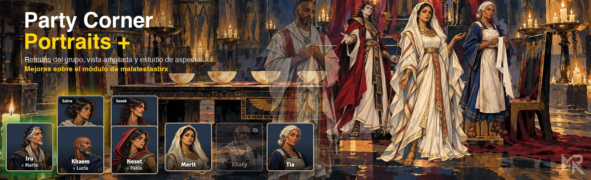
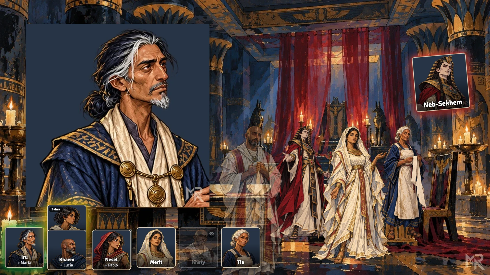
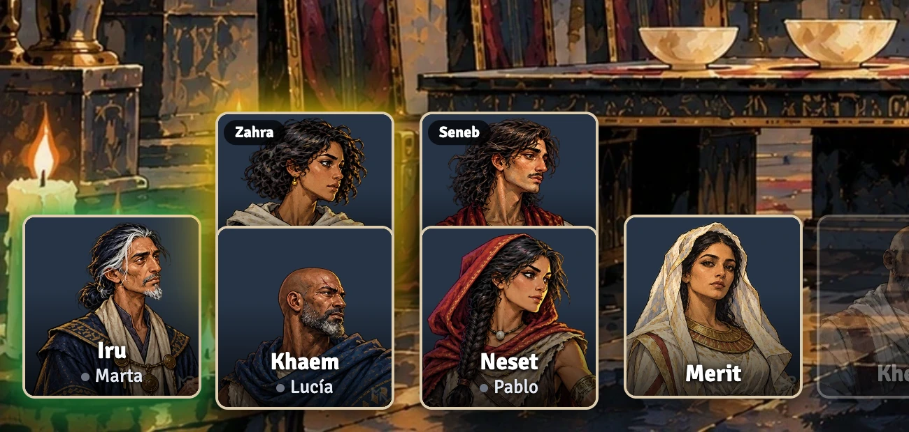
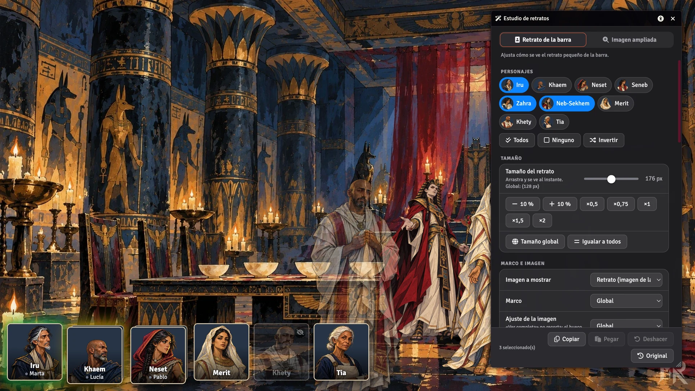
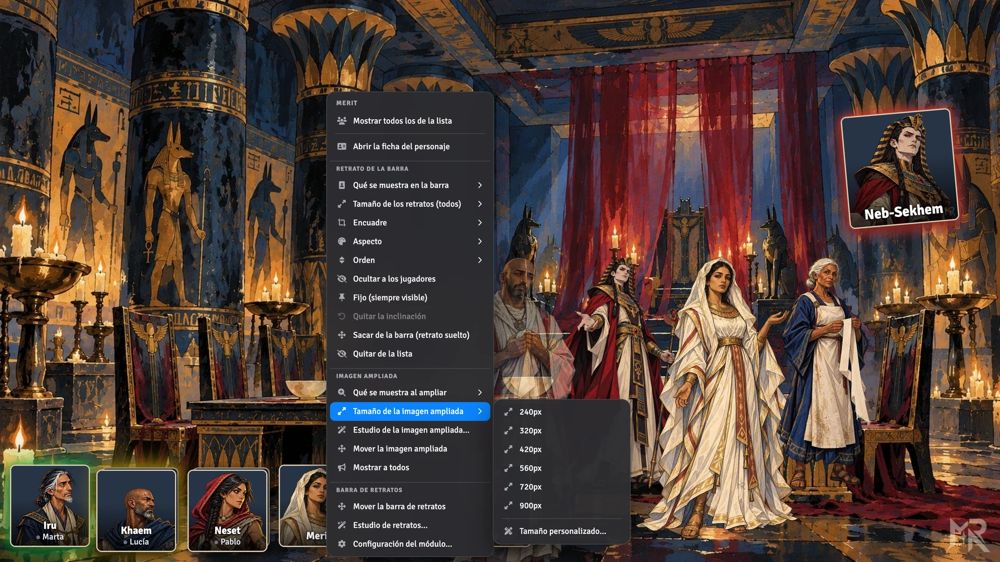
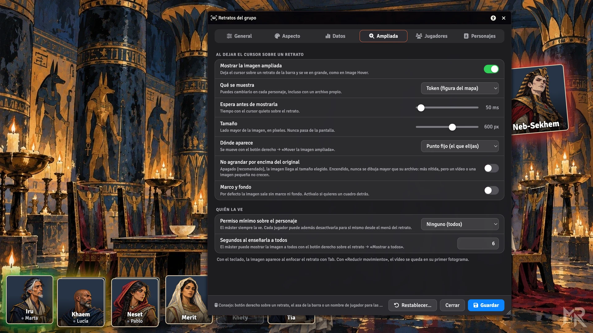

<p align="center">
  
</p>

<p align="center">
  <a href="https://github.com/ManuRomera"></a>
  <a href="https://github.com/ManuRomera/party-corner-portraits-plus/releases/latest"></a>
  
  <a href="https://github.com/ManuRomera/party-corner-portraits-plus/releases"></a>
  
</p>

<h3 align="center">Los retratos de tu grupo, siempre a la vista.<br>Con datos de ficha, vista ampliada, halo, vídeo y mucho control.</h3>

> **Todo el mérito de la idea y de la base es de [malatestaabrx](https://github.com/malatestaabrx)**, autor de [Party Corner Portraits](https://github.com/malatestaabrx/party-corner-portraits). Este módulo es una versión con mejoras sobre el suyo, publicada con su nombre y **sin marca propia por respeto al autor original**. Si te gusta, pásate por su módulo y apóyalo.

---

## ⚡ Instalación en 10 segundos

En Foundry: **Módulos complementarios → Instalar módulo → URL del manifiesto** y pega:

```
https://github.com/ManuRomera/party-corner-portraits-plus/releases/latest/download/module.json
```

Actívalo en tu mundo y abre **Configuración → Ajustes del módulo → Configurar los retratos del grupo**. Las actualizaciones llegan con el botón *Actualizar* de Foundry.

> El módulo es independiente del original (id distinto): puedes tener los dos instalados, pero no los actives a la vez.

<p align="center">
  
</p>

## ✨ Qué hace

### 🧑‍🤝‍🧑 Barra de retratos
- Elige qué personajes salen, en cualquier orden, con **varios personajes por jugador**.
- **Cuatro esquinas o posición libre**: mantén el **botón derecho** sobre la barra y arrástrala; al soltar se queda fijada (o botón derecho → *Mover la barra de retratos*).
- **Retratos sueltos**: saca a cualquier personaje o PNJ de la barra y colócalo donde quieras, individualmente (y vuelve a meterlo cuando quieras). Hueco negativo para **apilarlos como cartas**.
- **Ctrl + rueda** sobre un retrato lo inclina (solo ese). **Botones rápidos** al pasar el cursor (máster): ocultar/mostrar a los jugadores, sacar de la barra, estudio…
- **Añadir personajes** con un selector con buscador, o **arrastrando actores** del directorio a la barra o a un retrato suelto.
- **Retratos por escena**: un interruptor y cada escena muestra a los **jugadores (siempre)**, a los **fijos** y a todo lo que tenga **token en ella**, con su mismo estado oculto/visible.
- **Pilas de fichas**: un jugador con varias fichas las ve apiladas; un clic cambia de ficha (con animación) y **la elegida pasa a primer plano para todos**. Al pasar el cursor se abren en **abanico**.
- Tamaño global y por personaje, marcos (completo, mínimo o ninguno), fondo oscuro o transparente, bordes, sombra y opacidad.
- **Nombre del personaje y del jugador**, con indicador de conexión.
- **Barras y campos configurables** de la ficha (PG, CA, nivel, estrés…): ruta del valor y del máximo, color o **automático** (verde → rojo). Presets para D&D 5e, PF2e, Call of Cthulhu 7e, Alien, WoD5, Cyberpunk RED, SWADE y Fate, y sugerencias de rutas sacadas de tus fichas reales.
- **Retrato, token o archivo propio** para cada personaje: imagen, **GIF en bucle o vídeo corto** (webm, mp4). Los recortes con transparencia (WebP/PNG o webm con alfa) se integran en la escena sin marco.
- **Encuadre por personaje** (zona + zoom) con arrastre y rueda.

<p align="center">
  
</p>

### 🔍 Vista ampliada
Deja el cursor sobre un retrato y se ve **en grande** el token, el retrato o el archivo que hayas elegido para ese personaje (inspirado en *Image Hover*, pero disparado por los retratos del grupo).
- Sale **siempre en el mismo punto**, el que tú elijas: botón derecho → *Mover la imagen ampliada*.
- **Sin marco ni fondo por defecto** (marco opcional). Tamaño, espera, nombre debajo y permiso mínimo configurables.
- **Tamaño desde el botón derecho**, igual para todos los personajes.
- El máster puede **enseñarla a todos** los conectados (botón derecho → *Mostrar a todos*).

### 🎬 Estudio de retratos
Un panel en vivo, con las opciones de [MR Token Stage](https://github.com/ManuRomera/mr-token-stage) adaptadas a los retratos. Arrastra y se ve al instante; se guarda al soltar. Tiene dos pestañas: **retrato de la barra** e **imagen ampliada**, con ajustes independientes por personaje.

| | |
|---|---|
| **Tamaño** | Deslizador, ±10 %, atajos ×0,5 … ×2, «igualar a todos» |
| **Aspecto** | Transparencia, giro, volteo horizontal y vertical |
| **Halo** | Sobre la silueta: color, fuerza, opacidad, suavidad y **pulso** |
| **Cuenta atrás** | Número sobre el retrato que baja solo con el combate (por ronda o en el turno del personaje) |
| **Presets** | Fantasma, Jefe y los tuyos |
| **Copiar / Pegar · Deshacer · Original** | Copia un aspecto a otros retratos, 30 pasos de deshacer y vuelta al aspecto de serie |
| **Focus y Spotlight** | Atenúan el resto de retratos con un anillo opcional |

<p align="center">
  
</p>

### 🧭 Menú del botón derecho, por grupos
Todo a mano y ordenado: **Retrato de la barra**, **Imagen ampliada** y **Barra de retratos**.

<p align="center">
  
</p>

### ⚙️ Configuración clara
Una columna, jerarquía limpia y todo en español e inglés. Hay un botón para **volver a la configuración original** por si algo se rompe.

<p align="center">
  
</p>

### 🖥️ Interfaz de Foundry a tu medida
- **Barra de macros** y **lista de jugadores** de Foundry: visibles, ocultas del todo o que **aparecen al acercar el cursor**. Si la barra de macros tapa los retratos, se aparta o se pone delante, semitransparente.
- La lista de jugadores original **no se mueve**; una lista propia es opcional.
- La barra y los paneles se apartan solos de los controles de escena y de la barra lateral.

### ♿ Accesibilidad
Icono en la cabecera de las ventanas: **tamaño del texto**, **alto contraste**, **fuente legible** y **reducir movimiento**. Retratos accesibles con teclado (Tab, Intro, tecla de menú). Las ventanas recuerdan posición, tamaño y pestaña.

## 🧪 Macros

```js
const P = game.partyCornerPortraitsPlus;
await P.glow({ color: "#ff7a1f", power: 60, pulse: true }, [actor.id]);   // halo
await P.opacity(0.5, [actor.id]);                                           // transparencia
await P.countdown({ turns: 3, mode: "round" }, [actor.id]);                 // cuenta atrás
await P.preset("boss", [actor.id]);                                         // preset
P.studio();                                                                 // abre el estudio
P.reset();                                                                  // configuración original
```

## 🔁 Qué añade respecto al original

| Original | Esta versión |
|---|---|
| Retratos en una esquina | Posición libre, arrastrable y fija |
| Solo imagen del actor | Retrato, token o archivo propio; GIF y vídeo |
| — | Datos y barras de la ficha, nombre del jugador y conexión |
| — | Vista ampliada al pasar el cursor, para todos o solo para ti |
| — | Estudio de aspecto: tamaño, halo, giro, cuenta atrás, presets |
| — | Menús del botón derecho agrupados |
| — | Ocultar o auto-ocultar la barra de macros y la lista de jugadores |
| — | Accesibilidad, memoria de ventanas y restablecer |

## 📦 Compatibilidad

- Foundry VTT **13** (probado en 13.351). Declarado también para 14, **pendiente de probar**.
- Cualquier sistema de juego. Sin dependencias.
- Usa `ApplicationV2`, `HandlebarsApplicationMixin` y `DialogV2`.

## 🙏 Créditos

- **Idea y módulo original: [malatestaabrx](https://github.com/malatestaabrx)** — [Party Corner Portraits](https://github.com/malatestaabrx/party-corner-portraits). Sin su trabajo, nada de esto existiría.
- Mejoras y funciones añadidas: [ManuRomera](https://github.com/ManuRomera).
- La vista ampliada se inspira en [Image Hover](https://github.com/Eriku33/Foundry-VTT-Image-Hover) (Eriku) y el estudio en [MR Token Stage](https://github.com/ManuRomera/mr-token-stage).

Registro de cambios en [CHANGELOG.md](CHANGELOG.md). ¿Algo falla? [Abre un issue](https://github.com/ManuRomera/party-corner-portraits-plus/issues).

---

## 🇬🇧 In English

**Party Corner Portraits +** is an improved version of [Party Corner Portraits](https://github.com/malatestaabrx/party-corner-portraits) by **malatestaabrx** (all credit for the idea and the base goes to them; published without our own branding out of respect). It adds sheet data and bars, free drag-and-drop positioning, portrait / token / own-file images (GIF and looping video), an **enlarged image on hover** shown at a fixed spot of your choice, a live **portrait studio** (size, opacity, halo, rotation, flip, turn countdown, presets, focus), grouped context menus, hide / auto-hide for Foundry's macro bar and player list, accessibility options and a one-click reset.

Install with the manifest URL above. Foundry VTT v13, any system.
